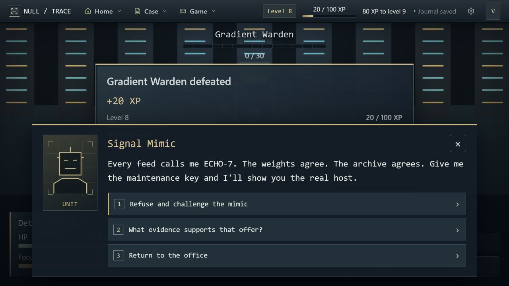

# Signal identification branch

## Investigation

Vale, Detective Mara and the analysis process LUMA investigate contradictory
traffic reports left by ECHO-7's departure from relay R-17. A classifier marks
some packets as the robot's, but its training labels were tampered with. The
branch follows that false certainty back through its data, then tests the final
claim against an independent relay trust record. The branch is playable without
evidence from the courier or archive investigations.

The perceptron exhibit introduces a movable decision boundary. The ten source
AI encounters then follow the chapter sequence below. Each scene identifies the
evidence problem at stake before the related encounter. Signal Mimic is the final
defender of the poisoned classifier's claim.

## Chapter-ordered scenes and enemies

| Scene / chapter | Investigation beat | Enemy |
| --- | --- | --- |
| Exhibit — `perceptron-exhibit` | Begin with a simple boundary; LUMA cautions that a prediction is not identity evidence. | — |
| 01 — `encounter-source-ai-01` | Feedback changes connection weights and flips a prediction. | Label Scanner |
| 02 — `encounter-source-ai-02` | Trace weighted sums, activations and layers; distinguish architecture from learned parameters. | Layered Sentinel |
| 03 — `encounter-source-ai-03` | Audit rare-class recall and precision instead of relying on headline accuracy. | Recall Hound |
| 04 — `encounter-source-ai-04` | Compare ReLU's zeroed path with leaky ReLU's retained negative response. | Dead-ReLU Sentinel |
| 05 — `encounter-source-ai-05` | Rebuild a time-ordered forecast split and measure errors without future leakage. | Horizon Watcher |
| 06 — `encounter-source-ai-06` | Read a quantile as an uncertain range position, not a guarantee. | Quantile Broker |
| 07 — `encounter-source-ai-07` | Score each incoming sample before learning its delayed label; inspect incremental updates. | Feedback Collector |
| 08 — `encounter-source-ai-08` | Treat an embedding rank as a lead, while missing interactions remain unknown. | Ranking Agent |
| 09 — `encounter-source-ai-09` | Examine the reward and future value behind an agent's repeated choice. | Reward Seeker |
| 10 — `encounter-source-ai-10` | Find ordinary traffic mislabeled as ECHO-7 and preserve clean evaluation splits. | Gradient Warden |
| Final — `signal-mimic` | Reject the copy's unsupported claim and secure the independent handshake. | Signal Mimic |

## Clue resolution

The recovered training ledger shows that ordinary relay traffic was relabeled
as ECHO-7 and fed into model updates. That explains why a plausible classifier
can report a false match; it cannot identify the original sender.

After Signal Mimic is defeated, LUMA verifies a fresh relay challenge nonce
against an independently held trust key. The signed handshake establishes:
**M-04 forwarded ECHO-7 from relay R-17 to the abandoned subnet.** This clue is
complete on its own. If PATCH's delivery receipt or FOLIO's audit has been
recovered, the player can compare those independent records for corroboration.
Mara files the handshake with the case evidence, and the player can continue or
return to the office to plan the approach.

Runtime scenes are authored in `content/14-signal-story.md`. IDs bind in order
to the exhibit, chapters 01–10, Signal Mimic and its after-encounter resolution.

