# Validation · 2026-11-07

## Signal identification branch

84 tests pass; production build validates 282 records. Three Luna subagents authored the signal narrative, added branch playthrough tests, and audited integration plus experiment persistence. Signal identification now has LUMA, twelve introductory scenes, ten chapter-aligned opponents, Signal Mimic, and a recoverable ending. Its independently verified handshake identifies M-04, R-17 and the abandoned subnet. The story supports pursuing this branch before the other two.

The lab now offers Continue investigation after successful calibration. Samples, weights, training settings and test state persist through IndexedDB and JSON exports. Missing experiment data in older saves defaults to null; malformed imported experiments are rejected. A long chapter brief now keeps its footer within the viewport.

Browser playthrough completed the lab with four examples and ten epochs, obtained 6/6 held-out matches, restored the trained experiment after reload, completed all ten guided chapters and encounters, earned two levels, defeated Signal Mimic, reloaded before filing, resumed Read conclusion, and claimed the signal reward once. The quest screen displayed Reward claimed and ECHO-7 became available alongside the two previously completed branches. The original reduced-motion setting was restored. Tests also cover a fresh independent branch, healing, defeat/retry, chapter mastery, reward duplication and final unlock requirements.

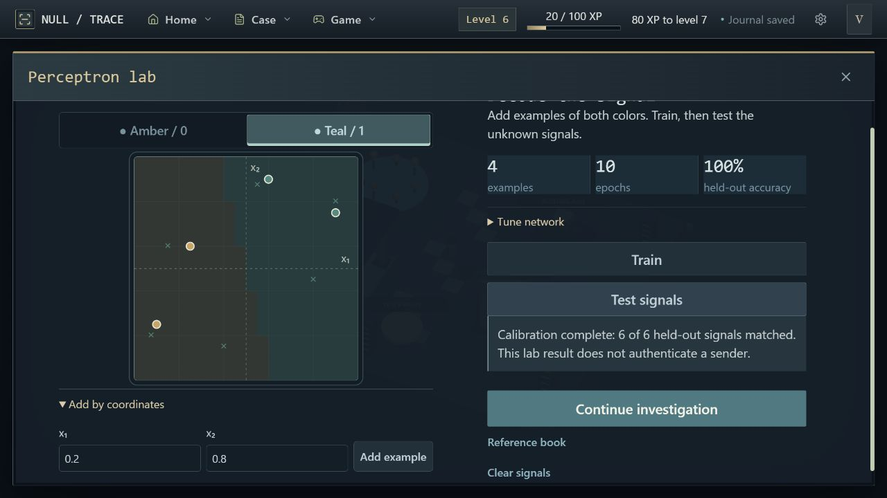

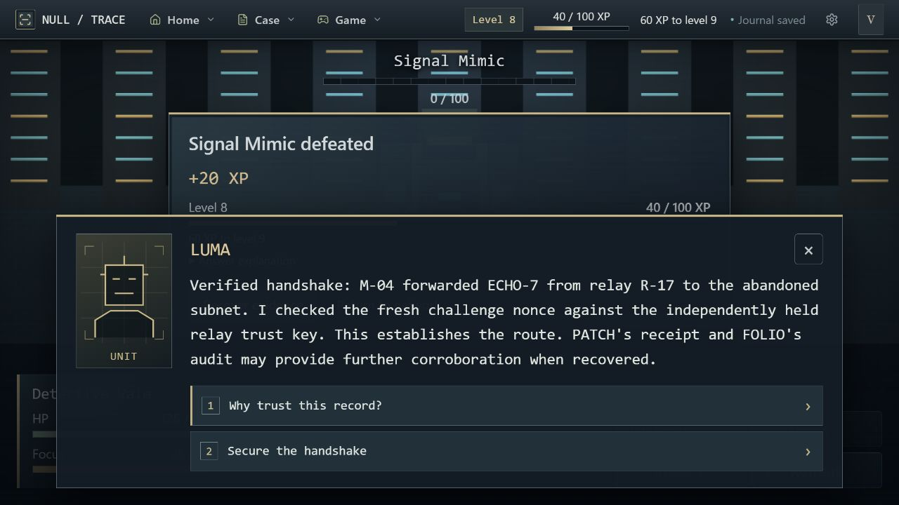

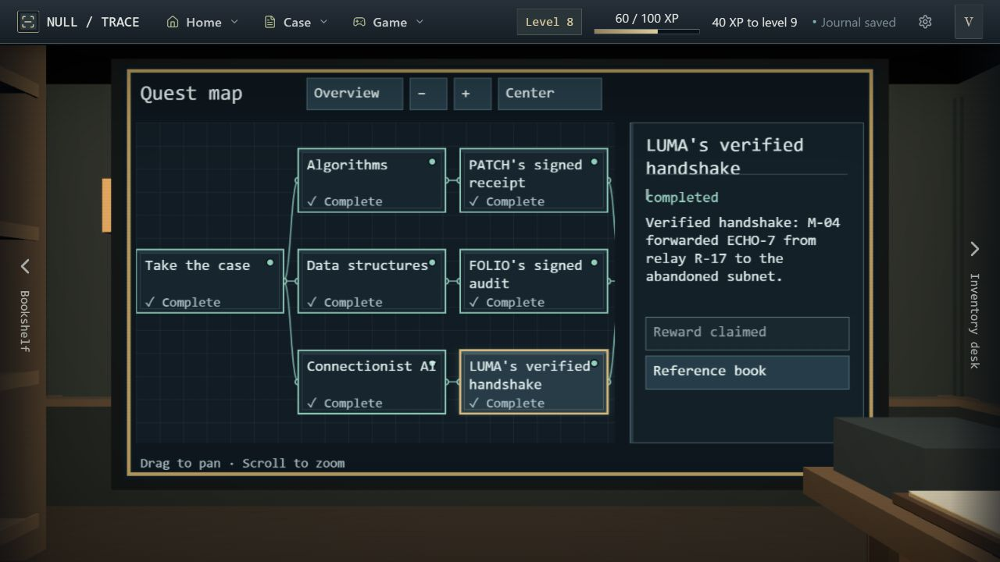

## Investigation interface pass

78 tests pass; production build passes with 269 validated records. Added a shared slate, teal and brass treatment across menus, chapter briefs, combat, settings and activity tools. The physical quest display now has a grid, connection sockets, framed nodes and clearer selected states. Text wraps at measured word boundaries. The desk ledger has printed equipment rows and skill cards. Full-screen books retain paper pages with an icon toolbar; equipment cards show item types and equipped state.

Browser checks at 1280 × 720 covered menu navigation, selecting quest nodes by keyboard, chapter concept/example/practice transitions, full-screen reading, the physical ledger, compact settings, and combat Skills → Probe → question → Retreat. The top bar and XP stayed visible. Practice options use 18px text and chapter progress reflects the current stage. Existing rewards and save formats are unchanged.

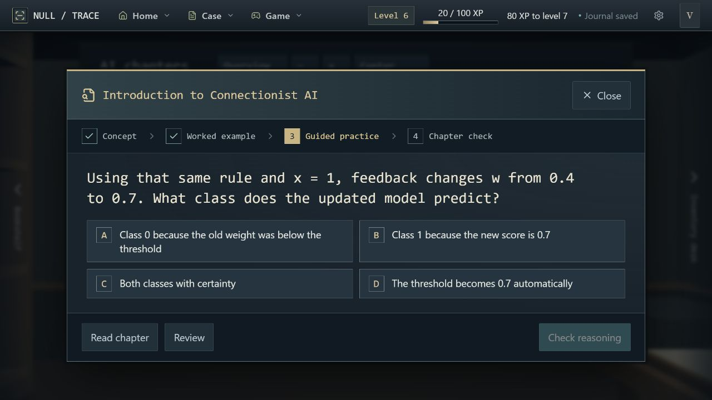

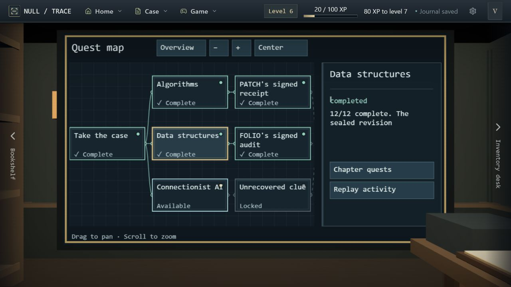

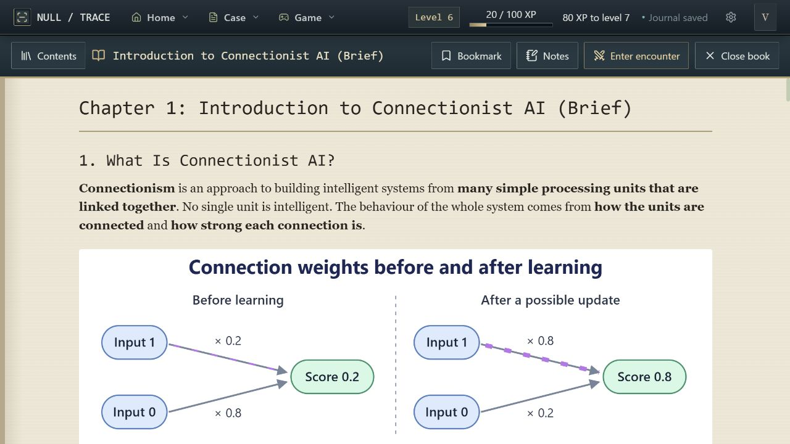

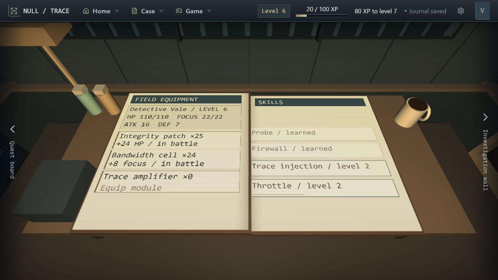

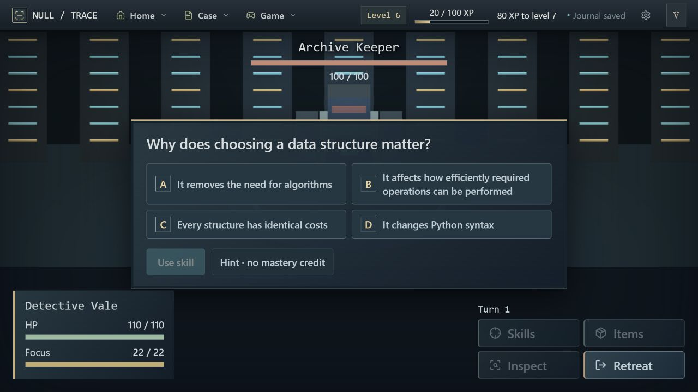

## Typewriter dialogue

78 tests pass; production build validates 269 records. Dialogue now uses a bottom conversation panel, speaker portraits, 22px typewriter text, punctuation pauses and numbered responses. Click or Space reveals the line without choosing a response. Reduced motion displays the complete line immediately; screen readers receive each complete line once.

Browser checks at 1280 × 720 covered partial typing, Space and button reveal, numbered branching, keyboard close during typing, reverse Tab focus, Escape and reduced motion. Choices reserve space while typing, so the panel stays still. The top bar remains visible. The original reduced-motion preference was restored after testing.

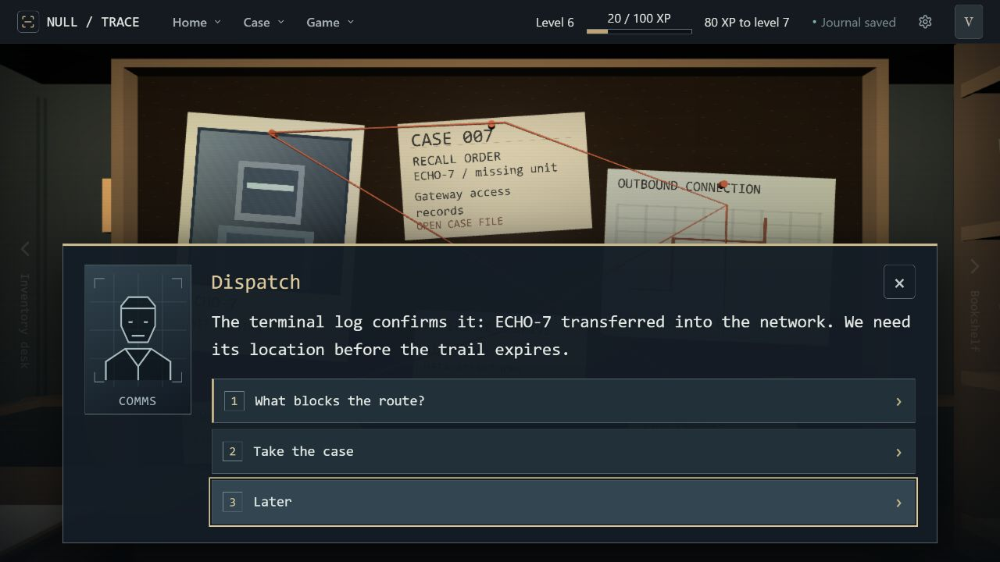

## Material-based chapter progression

76 tests pass; production build passes with 269 validated records. Added 31 chapter quests matching all numbered Source chapters, with learning goals, concepts, worked examples, distinct applied practice and explanations. New tests cover complete chapter coverage/order, safe wrong-answer retries, guided evidence versus unaided mastery, save restoration, invalid chapter imports and the chapter maps. A parser regression test preserves Python fences nested in YAML worked examples.

Browser checks covered the subject overview, Algorithms chapter map, concept and worked-example views, an incorrect practice response with reasoning, a successful retry and entry into the chapter encounter. Completed encounters and XP from the existing journal remained intact. Guided practice did not award XP or consume HP/focus. Chapter maps preserve readable text, pan/zoom, Center, Overview and keyboard controls.

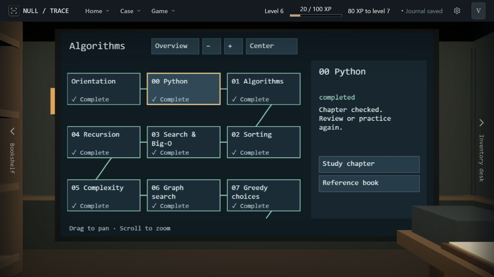

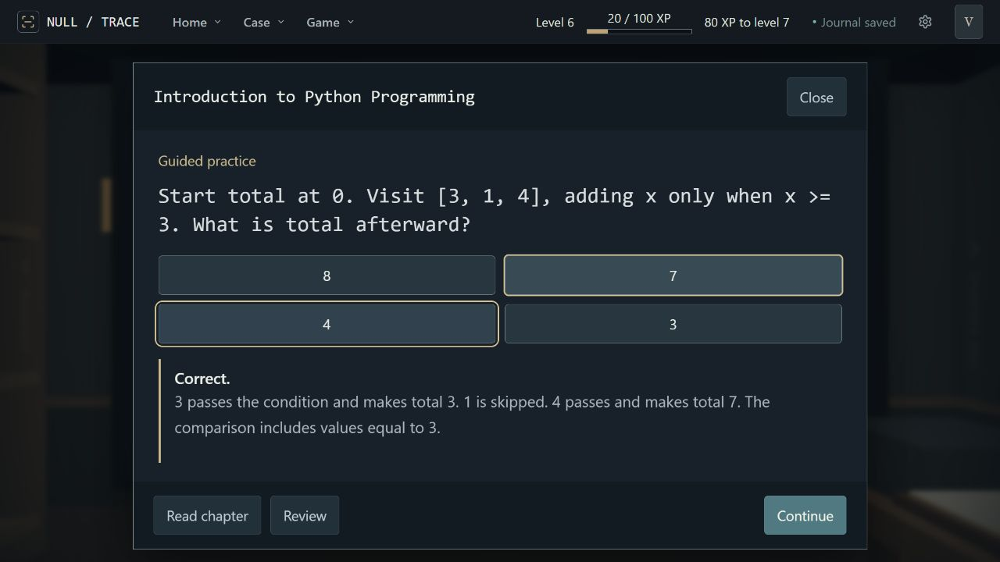

## Playable routing and archive stories

70 tests pass; production build passes with 238 validated records. Both branches now have complete model playthroughs from fresh characters, including encounters, dialogue/save restoration, first-clear progression, branch-local reward claims and ending recovery. Routing also traverses the real maze model; Access records completes independently and exercises healing items. Duplicate story triggers and unknown saved dialogue IDs are rejected. Imported saves clear transient conversations and pending cutscenes.

Browser QA played Routing trace from its introduction through the maze, all eleven chapter encounters and Route Warden, then resumed its pending ending after reopening the browser and filed the evidence. Sequential encounters remount their victory meter so XP summaries show only that encounter's gain. The conversation text and buttons use 20px and 18px text, with keyboard focus outlines and the persistent menu bar above.

Browser QA also completed Access records: gateway sentinel, all ten chapter encounters, Archive Keeper, optional ending conversation and evidence filing. Reloading before filing restored **Read conclusion**; filing awarded the archive reward and left the routing reward unchanged. The quest graph showed both clues complete, the claimed archive reward disabled and ECHO-7 still locked behind the remaining signal branch. Shortened the clue summaries to fit the physical quest screen; full evidence remains in the dialogue. No browser errors or warnings were recorded.

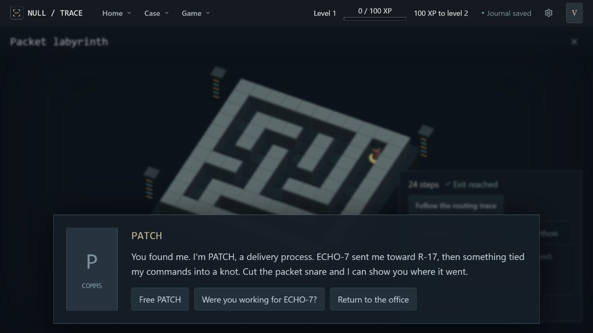

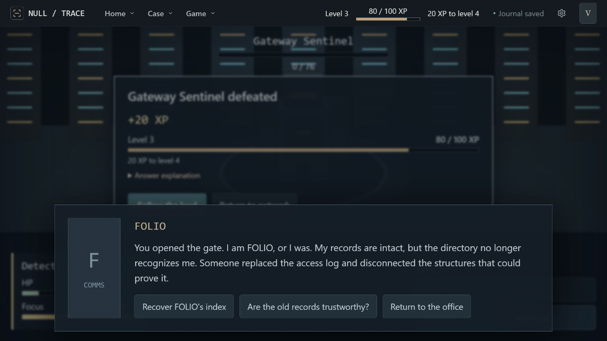

## Complete Source curriculum

64 tests pass; production build passes with 211 validated records. Coverage checks verify all 405 archived file checksums, 31 chapter books and their local links, 82 imported objective questions, 13 written exercises with model answers, exact-set scoring, still versions of all 98 animated SVGs, chapter/boss ordering and old-save restoration. Existing maze, worker cancellation, combat, progression, quest graph and IndexedDB checks remain passing.

Browser verification at 1280 × 720 covered opening a physical volume, the searchable chapter contents, full-screen lesson text and tables, diagrams (15 loaded with no broken images in the probabilistic-forecasting chapter), links to prerequisite chapters, all 95 test-bank disclosures, and entry to a Python-specific chapter encounter. The quiz stays centered with the 3D enemy above and persistent top-bar XP. The book uses a light color scheme so the SVGs' dark-mode labels do not disappear on white backgrounds. No browser warnings or errors were recorded. PyTorch examples are external reading examples and were not executed in the maze worker.

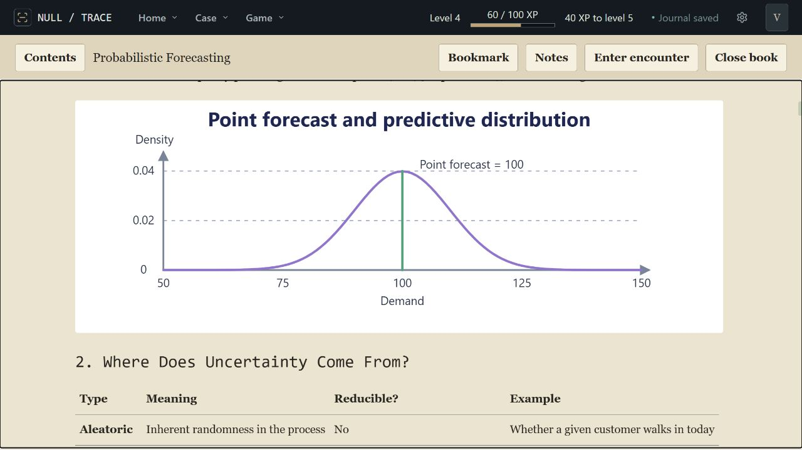

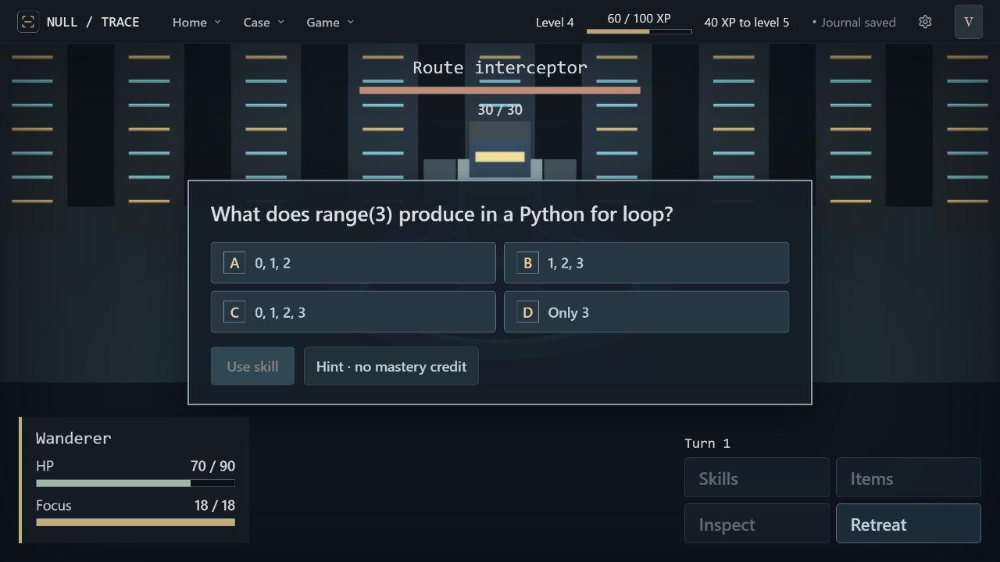

## Persistent top-bar XP

57 tests pass; production build passes. Level, XP progress, and XP to next level now appear in the global top bar. Removed the duplicate battle XP box; the victory reward meter remains. Shared XP styles are independent of the battle component. Initial save loading remounts the compact meter so restored XP does not look like a newly earned reward.

Browser checks covered the office and ECHO-7 encounter at 1280 × 720: all menus and top-bar XP labels fit, and combat retains only HP/focus in its player HUD. No browser warnings or errors were recorded.

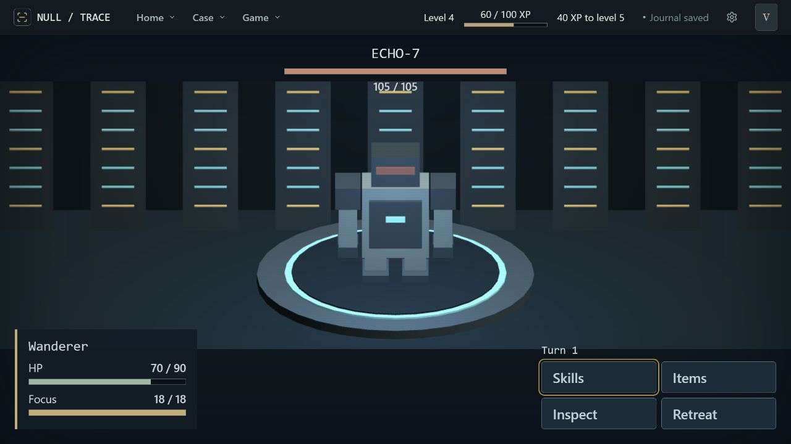

## XP interface

57 tests pass; production build passes. New XP display tests cover starting progress, 99 → 100 XP, partial progress after leveling, and the level-100 cap. Combat now presents a persistent XP meter plus victory XP, animated progress, level-up stat gains, and available skills. Reduced motion skips the progress animation.

Browser checks confirmed level 4, 60/100 XP, and 40 XP needed for level 5 in the HUD. Replaying the sentinel showed “XP already earned” at victory and left progress unchanged. The reward panel and its progress bar remained readable; no browser warnings or errors were recorded. First-clear rewards and stat calculations remain covered by the existing progression tests.

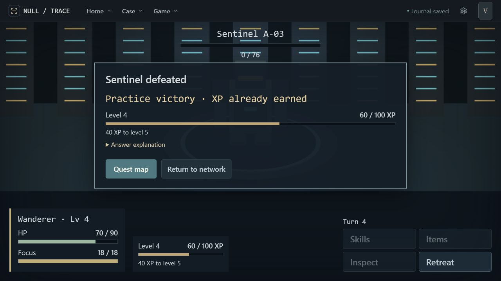

## RPG battle composition

56 tests pass; production build passes. Added transition tests distinguish hits, wrong answers, finishing hits, item turns, poison victories, and non-action state changes. Existing combat/progression tests remain unchanged.

Browser checks confirmed centered enemy HP, a central quiz, player HP/focus bottom-left, and the four command controls. A correct answer reduced enemy HP from 76 to 56, hid the quiz during the attack, and displayed feedback. Continue resolved the enemy turn. An Integrity patch reduced inventory from six to five, restored HP, and spent a turn. Inspect showed the recent events without spending another turn; Escape returned from its submenu. Retreat returned to the network. Enemy framing shifts during the quiz so its head remains above the panel. Attack transitions respect the saved reduced-motion preference.

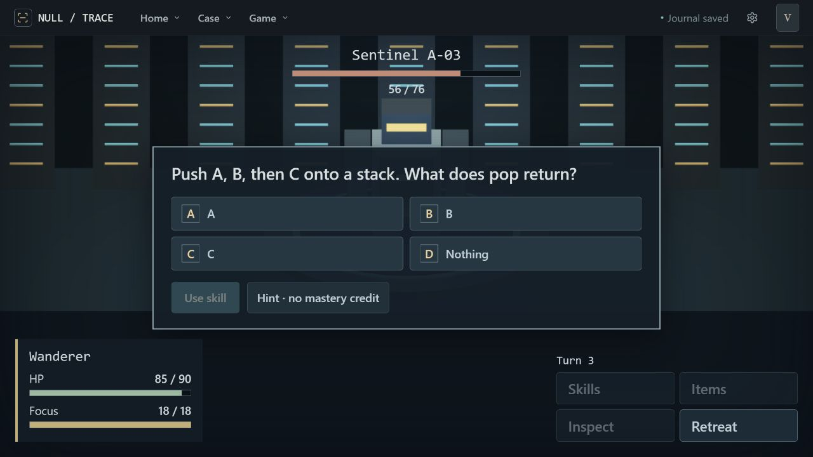

## Interactive quest graph

54 tests pass; production build passes. New coverage checks node/edge references, hidden evidence, activity completion unlocking the finale independently of reward claims, cursor-anchored zoom, navigation bounds, and centering.

Browser checks covered dragging without activating a node, wheel zoom, actual ray-picked node selection, keyboard panning without turning the room, off-screen boss selection and centering, Overview reset, and a reference action opening the correct full-screen book. No browser warnings or errors were recorded. The graph uses the three currently implemented branches; additional story questlines remain design work.

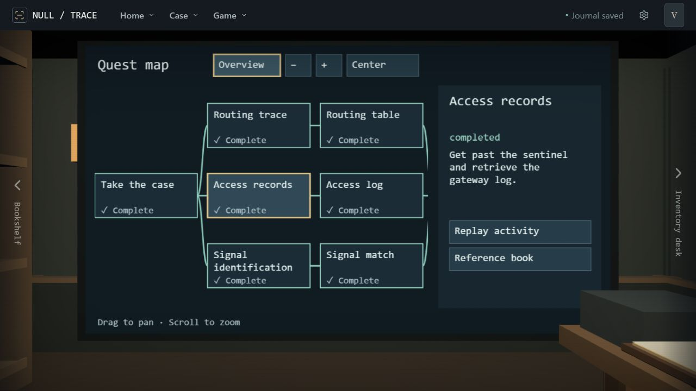

## Digital quest screen

Replaced the quest folders with one illuminated world-space display and dark bezel. Existing quest gates, rewards, hover outlines, and keyboard controls remain shared with the gameplay models. Browser checks verified readable text and a ray-picked reference button opening its full-screen book. 51 tests pass; production build passes.

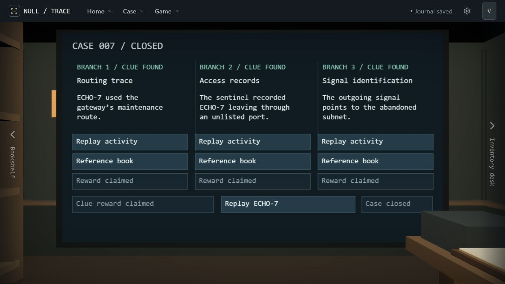

## Full-screen library books

51 tests pass; production build passes. Viewport-fit coverage checks standard, tall, and ultrawide aspect ratios without clipping either cover. Browser checks confirmed full-screen framing, the hidden room, a steady camera, accessible page controls, and room navigation returning after closing. The opening/closing animation and top menu bar remain intact. No browser warnings or errors were recorded.

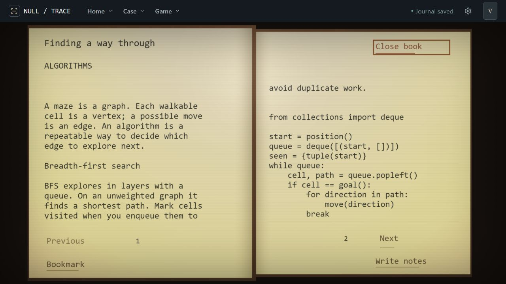

## Physical office and activity interfaces

50 tests pass; production build passes. New tests cover pull-before-open sequencing, the cover swinging toward the reader, bounded animation poses, separate shelf/book controls, and page bounds.

Browser checks at 1280 × 720 covered pinned evidence ray picking and hover outlines, fast edge entry, the flatter desk view, physical volume selection, opening/closing, pagination, and note editing/cancellation. The office rendered with WebGPU and forced WebGL2. Babylon move picking is enabled explicitly so normal foreground geometry still occludes hover targets.

The maze shows the world with a compact movement HUD and optional code dock. A quiz turn applied damage and resolved the enemy turn; the Items drawer opened correctly. The simplified perceptron activity trained four labeled examples for 10 epochs and scored 100% on held-out points. Its reference link opened the matching book. Automatic renderer preference was restored after checks.

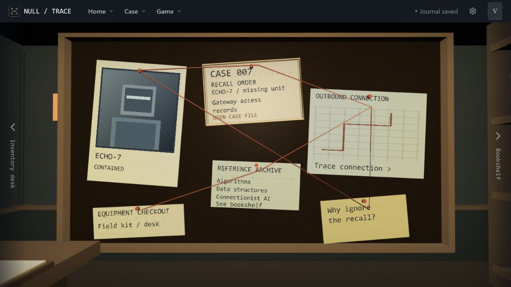

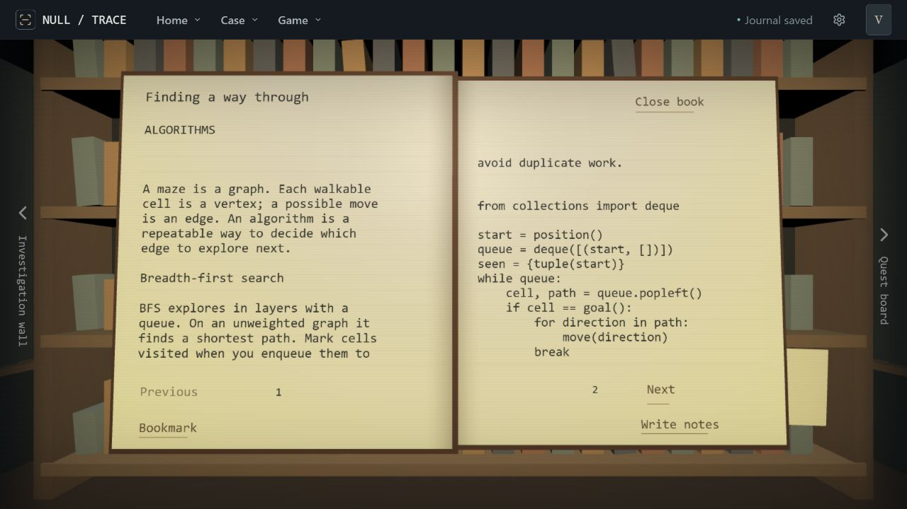

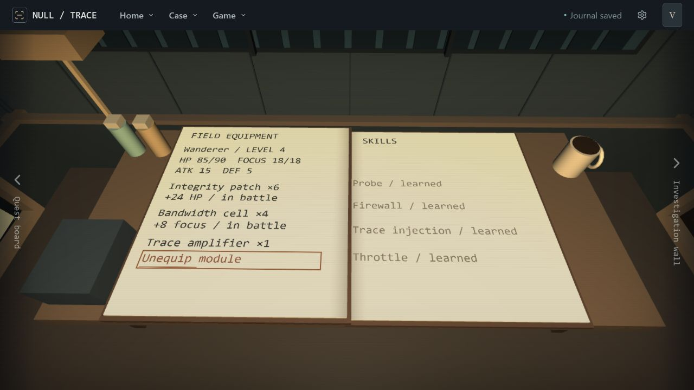

## Velocity-driven turn blur

47 tests pass. Added checks for speed/direction, equal velocity at different frame rates, bounded streak length, stationary/reduced-motion clearing, and delayed-frame recovery. Production build passes.

Browser checks confirmed horizontal turn streaks in both WebGPU and WebGL2 without shader errors, sharp text at rest, and immediate sharp turns with reduced motion. The old CSS blur pulse was removed; the render pass is detached while idle.

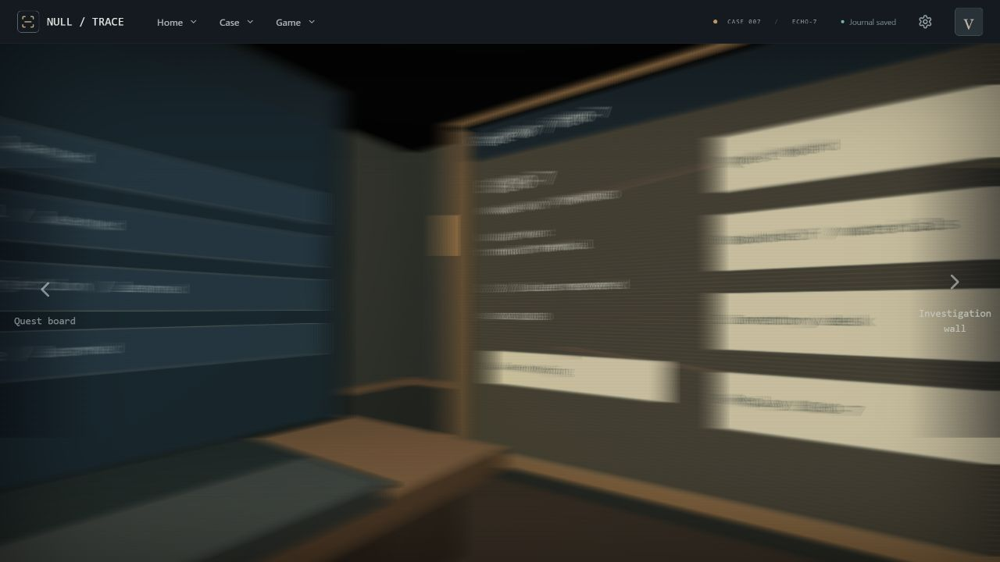

## Mesh interface and edge turns

44 tests pass. The new ray-picking test imports the production surface module, hits an actual Babylon plane, reads its UVs, and verifies a foreground mesh blocks it. Other checks cover control bounds, disabled actions, quest gates, lesson pagination/search, Python operator preservation, note drafts, and cyclic left/right turns.

Browser checks covered textured home surfaces in WebGPU and forced WebGL2; ray-picked navigation, lesson selection, page turning, search, notes, equipment, and skill unlocks; and keyboard activation with mesh focus. Click, hover, and arrow-key room turns were exercised. Hover turns once per edge entry. Props were moved so they do not cover the terminal controls. Global settings retain the readable screen interface.

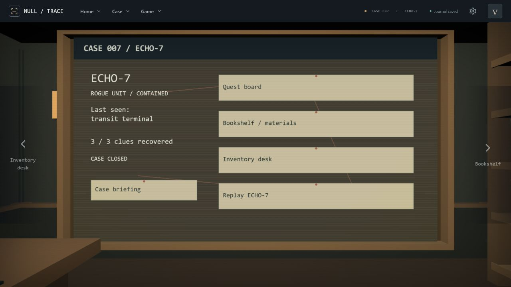

## Branches and robot finale

38 tests pass. New coverage exercises all six branch completion orders, optional reward claiming for unlocks, prerequisite validation/cycles, duplicate rewards, premature finale-save rejection, and a complete final battle across all material topics.

Browser checks confirmed the boss was locked at one clue, unlocked at three clues, and completed successfully. Branch rewards and the case reward were claimed once; reloading restored the closed case and disabled reward buttons. Text now uses local regular-weight UI fonts and typewriter headings.

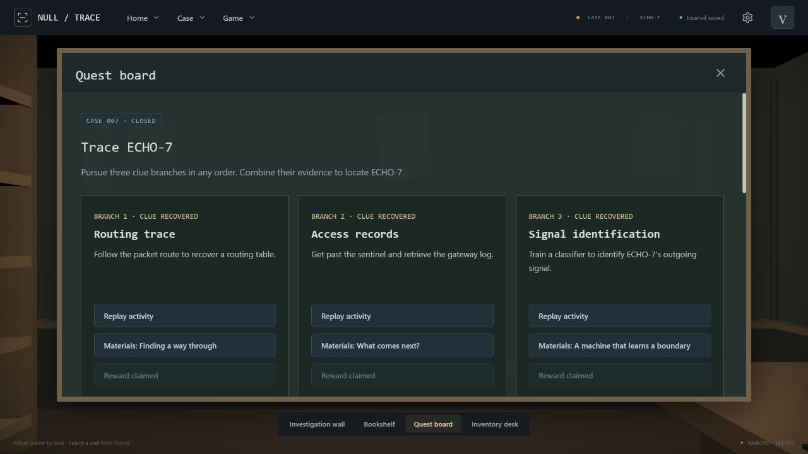

## Home room update

34 tests pass, including new dialogue validation, story-save migration, configurable cutscene frames, and camera turns across the angle boundary.

Browser checks covered all four room walls, top-menu dropdowns, library search, the branching briefing and case acceptance, the first-connection cutscene continuing into a selected quest battle, intro replay, and clue display. The menu bar stayed visible during dialogue and both cutscenes. The first-person room rendered with WebGPU and forced WebGL2. Reduced motion switched walls without blur or camera interpolation.

The room and characters use procedural placeholder art. Blur is a screen filter during the camera turn. Existing maze, combat, and progression behavior remains covered by the tests below.

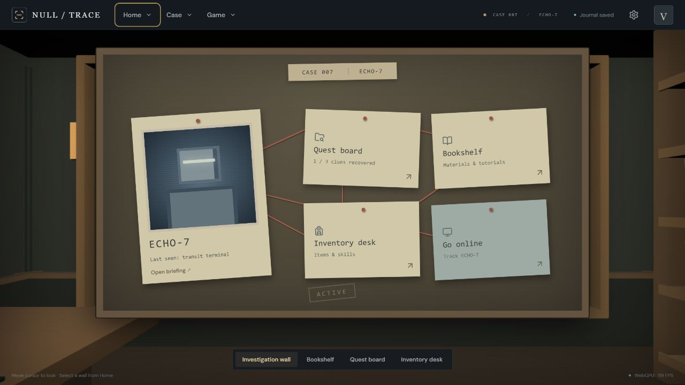

## Foundation checks

`npm test`: 31 tests passed. `npm run build`: content validation, TypeScript, and production bundling passed.

Automated coverage includes 200 solvable maze seeds, deterministic generation, alternate routes, shared movement rules, command budgets, combat turn order and effects, item consumption, defeat, unique rewards, mastery, progression, content references and cycles, save validation, IndexedDB, and worker cancellation/stale messages/deadlines. Legacy saves without prologue progress load successfully.

## Browser checks

Tested in the desktop app browser at 1280 × 720:

- Prologue pursuit, replay, keyboard skip, and focus return.
- Selectable detective desk, network transitions, library search, notes, bookmarks, and save restore.
- Seed 42 completed manually, through Blockly-generated Python, and through handwritten BFS. Each reached the exit in 24 movement steps.
- Quiz combat, perceptron objective, quest reward, level 2, equipment, and skill unlock. Full progression was checked on the foundation before the detective presentation changes; a correct quiz turn was rechecked afterward.
- Real Python pause, one-line step, stop, and successful execution after worker replacement. An infinite loop hit the 30-second execution limit and returned control. Missing headers, stale responses, and the unresponsive-worker watchdog are covered by runner tests.
- Automatic WebGPU and forced WebGL2 both rendered successfully. Forced renderer initialization failure and complete GPU context loss were not injected in the browser.

## Frame captures during Python

Ten-second captures began in Settings and continued through maze opening, Python loading, and an infinite loop. Frame times include scene changes, UI work, and scheduling. These are development-browser measurements, not isolated GPU timings or a hardware-wide comparison.

| Backend | Average | p95 | FPS | Frames |
| --- | ---: | ---: | ---: | ---: |
| WebGPU | 8.6 ms | 16.7 ms | 117 | 1262 |
| WebGL2 | 8.5 ms | 17.0 ms | 118 | 1279 |

The measured difference is too small to establish a performance advantage. Capture statistics aggregate individual frame intervals. Rendering stayed responsive while Python executed in its worker.

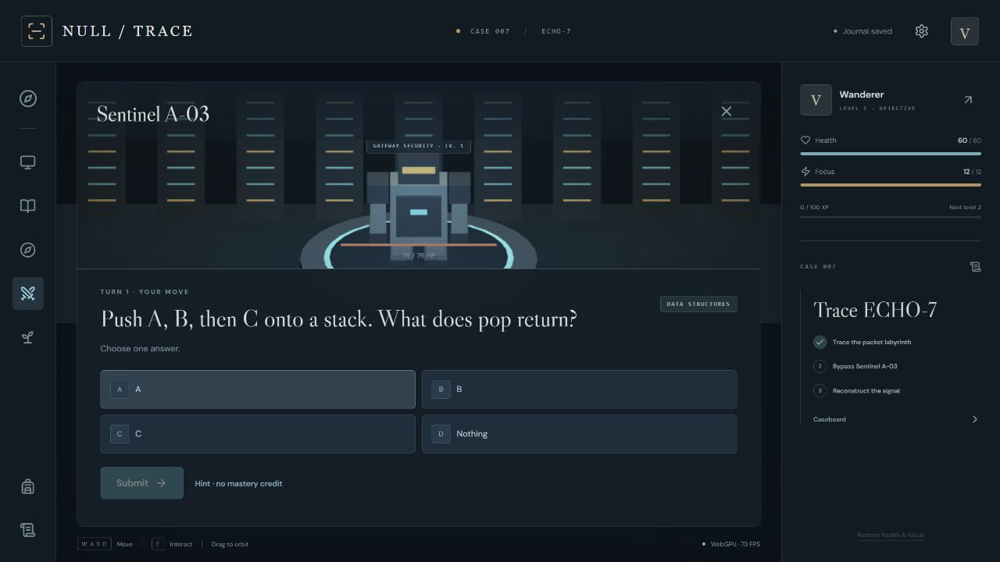
